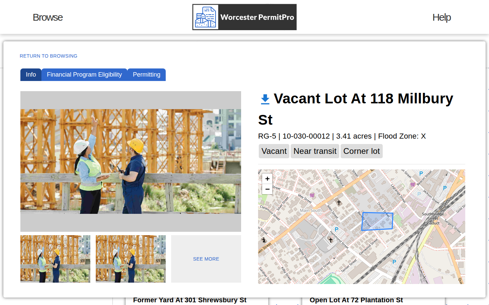
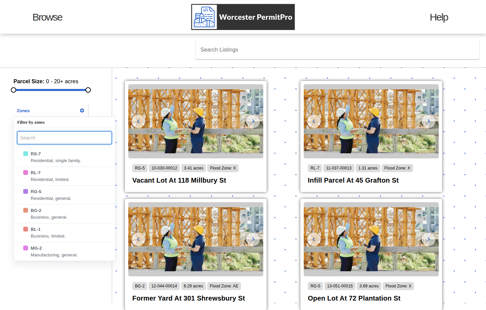
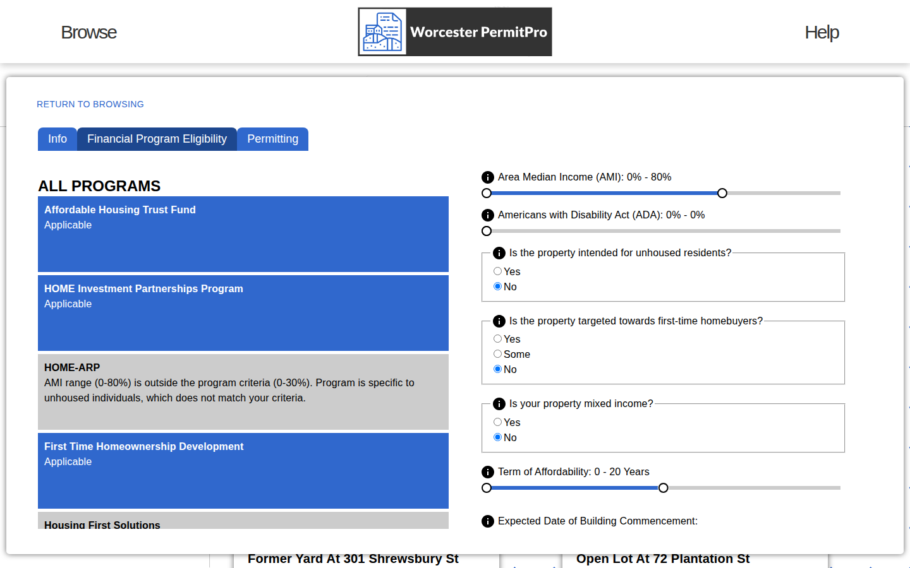
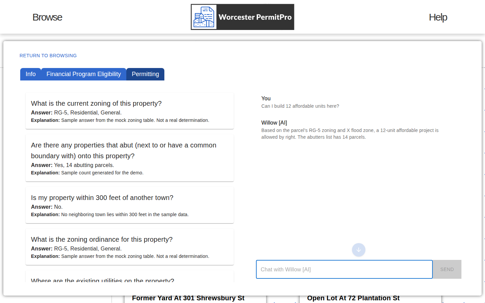

# Worcester PermitPro

[](LICENSE)
[](#install)
[](turbo.json)
[](apps/Willow-Front-End-Node)
[](packages/database)
[](fintechMQPsmartcontract.sol)

**Site selection and due diligence for affordable housing in Worcester, Massachusetts, on one map.** PermitPro pulls the city's parcel, zoning, assessment and flood-zone layers into a PostGIS database, shows every candidate parcel with its constraints, scores it against the city's housing financing programs, and runs a permitting analysis with an AI assistant. Permit and assessment records can be anchored on chain as hashes so that off-chain data can be verified later.



Built as a Worcester Polytechnic Institute Major Qualifying Project in autumn 2023, in collaboration with the City of Worcester's Chief Development Officer. The City of Worcester now owns and operates the platform in its low-income housing development pipeline.

## Why

Affordable housing projects in a mid-sized city die in due diligence. A developer has to find a parcel, pull its zoning and assessment from separate city systems, check the flood map, work out which of the city's financing programs the project could qualify for, and then guess at permitting. Each step lives in a different office with a different file format. PermitPro collects those layers once, keeps them in one database, and answers the first questions about a parcel in one view.

## What it does

- **Browse parcels on a map.** The home page draws Worcester's boundary and every listed parcel polygon on OpenStreetMap tiles. Browse filters listings by zone and acreage and shows each one as a card with its zone, parcel id, acreage and FEMA flood zone.
- **Inspect a parcel.** Three tabs: Info (address, assessments, land use, zone, flood zone, parcel map, JSON export), Financial Program Eligibility (sliders and toggles for area median income, ADA units, mixed income and affordability term, matched against sixteen financing programs, including the Affordable Housing Trust Fund, HOME, HOME-ARP and First Time Homeownership Development), and Permitting.
- **Permitting analysis and chat.** When a listing is collected, an OpenAI Assistant answers a 27-question permitting checklist (zoning, abutters, proximity to a town line, floodplain, traffic, amenities) and the answers are stored with the listing. The Permitting tab renders answer and explanation per question, and a chat box beside it asks the assistant follow-ups about the same parcel.
- **Collect city data.** A collector service reads the City of Worcester's ArcGIS Open Data services (regulatory zoning, property parcels, structures and addresses), the FEMA flood-zone feature service, a municipal-boundary service for parcels within 300 ft of another town, and the Vision Government Solutions property cards for assessments, land use and photos.
- **Anchor records on chain.** A `PermitManagement` contract with owner, approver, assessor and developer roles stores permits and assessments as records with hashes of their GIS data. A `verifyOffChainDataHash` call checks a stored hash against the database copy. The contract is deployed to the Goerli test network and driven by a small MetaMask dApp.

## How it works


A listing starts with an address posted to the collector. The collector pulls the parcel polygon, zoning, addresses, assessments, land use, photos, flood zone and neighbouring towns from the city and public services, asks an OpenAI Assistant for a description and the permitting answers, and writes everything to PostGIS. The API serves listings and zones to the web app. On chain, only hashes of permit and assessment records are stored, so a record in the database can be verified later by rehashing it.

## Walkthrough

The screenshots below come from a local run with six sample listings and sample answers, so the parcels, prices and permitting answers are illustrative and the photos repeat.







## Architecture

| Package | Role | Stack |
|---|---|---|
| `apps/Willow-Front-End-Node` | Web app: home map, browse, inspect, permitting, chat | React 18, Vite, MUI, react-leaflet |
| `apps/Willow-Back-End-Brain` | API for the web app: `GET /Listing`, `GET /Zone`, `POST /Interest` on port 3001 | Express, TypeScript, Prisma |
| `apps/data-collector` | Builds listings from an address: GIS layers, property cards, images, AI description and analysis, on port 2999 | Express, ArcGIS REST, cheerio, OpenAI |
| `packages/database` | Schema and migrations: Address, Parcel, Zone, LandUse, Assessment, FloodZone, Listing, Analysis | Prisma 5, PostgreSQL 16 with PostGIS |
| `apps/finMQPdeployHardhat` | The `PermitManagement` contract, its Hardhat deployment, a records API on port 4001 and a MetaMask dApp on port 4000 | Solidity 0.8, Hardhat, web3.js, Create React App |
| `shared/utils` | Shared constants, interfaces and the financing-program list | TypeScript |

Data flows collector → PostGIS → Brain API → web app. The chain holds hashes only. The full records stay in PostgreSQL and are verified by rehashing.

## Install

Requirements: Node 18 or newer, pnpm 8 (`corepack enable`), PostgreSQL 16 with PostGIS, and an OpenAI API key with three Assistants (summarizer, permitter and chatter).

```bash
git clone https://github.com/FinTech-MQP/Worcester-PermitPro.git
cd Worcester-PermitPro
pnpm install

# database
cp packages/database/.env.example packages/database/.env   # set DATABASE_URL to your WillowDB
pnpm --filter database exec prisma migrate deploy
pnpm --filter database exec prisma generate

# OpenAI
# shared/utils/API_KEY.ts exports OPENAI_API_KEY and shared/utils/constants.ts holds the three assistant ids.
# Fill them in locally and never commit a real key.
```

## Run

```bash
pnpm dev                                   # every app through turbo, or one at a time:
pnpm --filter Willow-Back-End-Brain dev    # API on :3001
pnpm --filter data-collector dev           # collector on :2999
pnpm --filter Willow-Front-End-Node dev    # web app on the Vite port
```

Populate listings by posting an address to the collector (`POST /api/listing`). It fetches the parcel, zoning, flood zone, assessments and photos, writes the AI description and analysis, and stores the listing. The web app then shows it on the map.

The web app imports the OpenAI client at page load. Without a key the home page stays blank, so set the key before starting it.

### Smart contract

```bash
cd apps/finMQPdeployHardhat
cp .env.example .env            # INFURA_API_KEY and PRIVATE_KEY for Goerli
npx hardhat run scripts/02_deploy_contract_finMQP.js --network Goerli
cd backend && npm install && node .          # records API on :4001, needs BLOCKCHAIN_DATABASE_URL
cd ../frontend && npm install && npm start   # dApp on :4000
```

The repo records two deployed contract addresses: `contract_address.txt` and `apps/finMQPdeployHardhat/frontend/src/contract-config.json`. Goerli is a test network, so neither is a production deployment.

## Layout

```
apps/
  Willow-Front-End-Node/    React web app
  Willow-Back-End-Brain/    Express API over Prisma
  data-collector/           GIS and property-card collector
  finMQPdeployHardhat/      contract, deployment, records API, dApp
packages/database/          Prisma schema and migrations
shared/utils/               shared types and constants
fintechMQPsmartcontract.sol reference copy of the contract
data-mqp-sql.sql            sample permits and assessments tables
```

## Credits

Phi Bui ([@phbui](https://github.com/phbui)) and Hasan Gandor ([@hzgand](https://github.com/hzgand)), with the project's WPI advisors Dr. Daniel Treku, Dr. Matthew Ahrens, Dr. Wilson Wong, Prof. Robert Sarnie, Prof. John Galante, Prof. Suzanne LePage and Prof. Sara Saberi, and the City of Worcester's Chief Development Officer. Map tiles by OpenStreetMap contributors. Parcel, zoning and address data from the City of Worcester's Open Data services and the Vision Government Solutions property database. Flood zones from FEMA.

## License

MIT. See [LICENSE](LICENSE).
